<p align="center"></p>

# Claude's Drawing Hand

A browser extension that gives claude.ai inline image generation. Claude writes a tag like
`[[image: a red fox in the snow | portrait]]` and the extension renders it right in the chat
using [Perchance](https://perchance.org)'s free text-to-image plugin. Since v0.4.0 it can also draw with
[Pollinations](https://pollinations.ai) or the [AI Horde](https://aihorde.net), both free (see [Engines](#engines)).

If you haven't tried it yet, I made these interfaces for it for direct prompting:

[Imagine-It](http://perchance.org/imagine-it)
</br>
[Image Donkey](http://perchance.org/image-donkey)

I got the idea by getting ChatGPT to use these web interfaces with its own prompts, and the results were amazing.

The extension works on desktop and on Android browsers that run extensions (Quetta, Edge Canary, Firefox Nightly, Iceraven and more; see the table below).


## Perchance Gallery

All of these images were made by Claude with Perchance: Claude wrote the prompts, and Perchance rendered them right in the chat through this extension. 

<p>
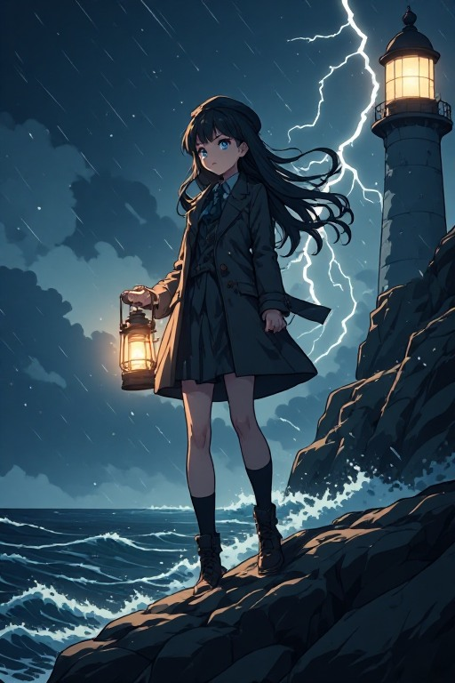

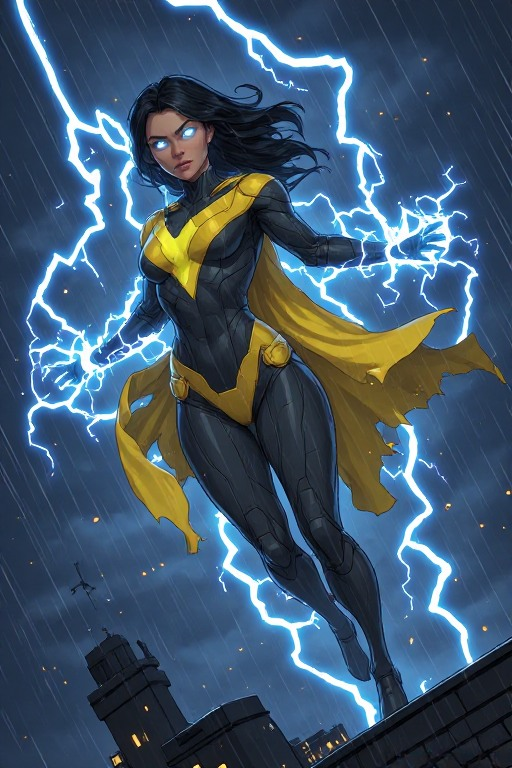

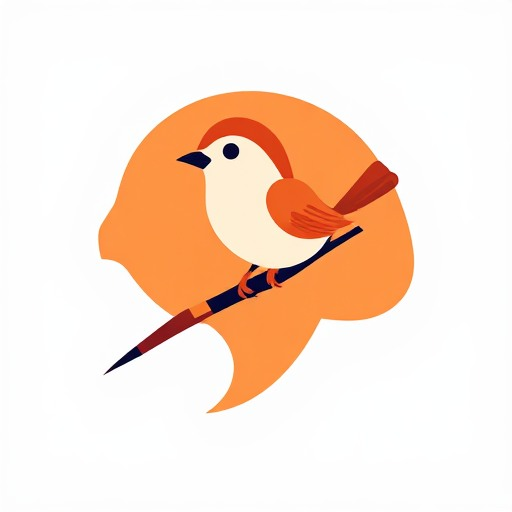

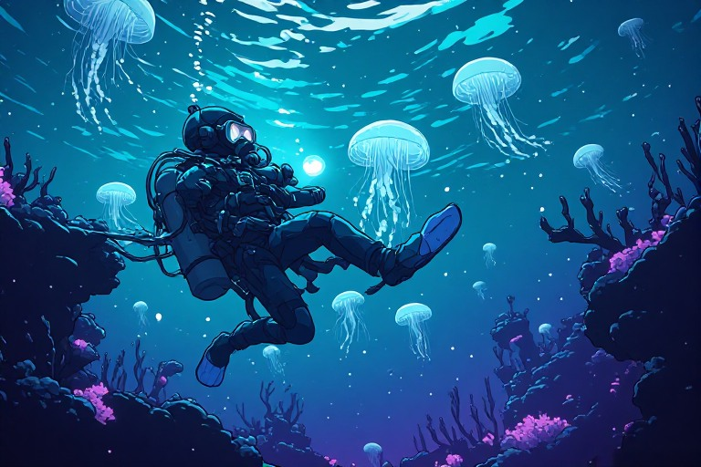

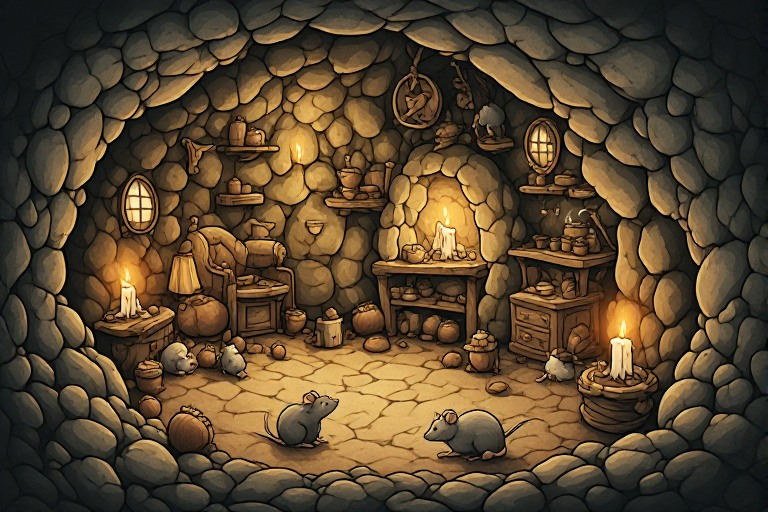


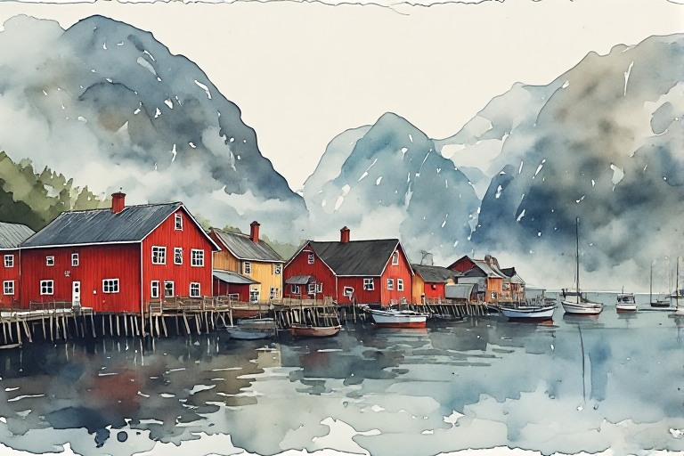


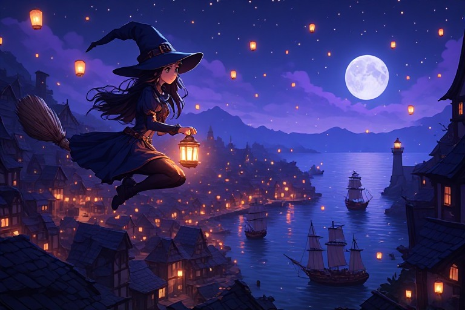


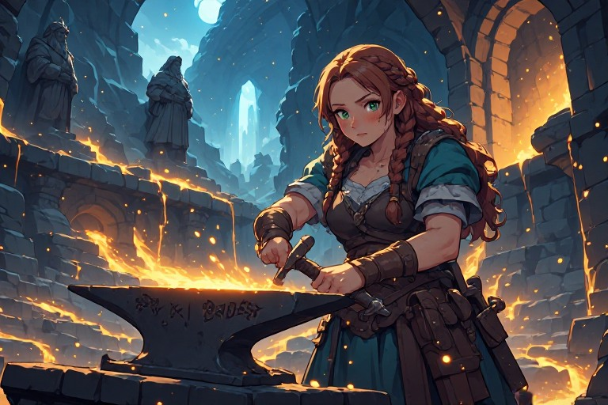

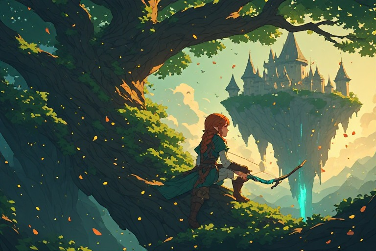

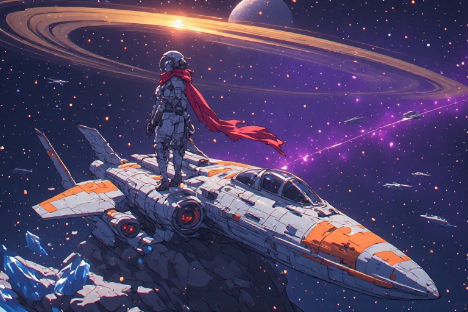


</p>

## Try it (no Perchance account needed)

The extension comes set to the public generator **claude-perchance**, so you can try it without making your own.

1. Download the file for your browser:
   [claude-perchance.zip](https://github.com/purdygeorgeedward-dev/Claude-Perchance/raw/main/packages/claude-perchance.zip) (Quetta, Chrome, Edge, Brave) ·
   [claude-perchance.xpi](https://github.com/purdygeorgeedward-dev/Claude-Perchance/raw/main/packages/claude-perchance.xpi) (Firefox Nightly, Iceraven) ·
   [claude-perchance.crx](https://github.com/purdygeorgeedward-dev/Claude-Perchance/raw/main/packages/claude-perchance.crx) (Edge Canary)
2. Install it:
   - **Quetta (Android):** menu ︙ → **Extensions** → **Developer options...** → turn on **Developer mode** →
     **(from .zip/.crx/.user.js)** → pick the zip. [Step-by-step with screenshots](#quetta-step-by-step-verified-on-georges-phone).
   - **Firefox Nightly / Iceraven (Android):** Settings → About → tap the logo 5 times → back to Settings →
     **Install add-on from file** → pick the .xpi. If it says the add-on isn't verified, set
     `xpinstall.signatures.required` to `false` in `about:config` first.
   - **Chrome / Edge / Brave (desktop):** unzip, open `chrome://extensions`, turn on **Developer mode**,
     **Load unpacked**, pick the folder.
   - **Firefox (desktop):** `about:debugging#/runtime/this-firefox` → **Load Temporary Add-on…** → pick
     `manifest.json` inside the unzipped folder (removed when Firefox restarts).
3. Paste the contents of [CLAUDE_INSTRUCTIONS.md](CLAUDE_INSTRUCTIONS.md) into Claude (Settings → Profile →
   personal preferences, or a project's instructions), then ask Claude for a picture.

Other Android browsers are in the [install table](#android-browsers). To use your own generator instead, follow
the setup below.

## Support

If Claude Perchance is useful to you, you can support George's work at
[buymeacoffee.com/GeorgeEdwardPurdy](https://www.buymeacoffee.com/GeorgeEdwardPurdy).

## How it works

1. Claude emits `[[image: ...]]` tags (you teach it with a short instruction snippet).
2. The extension spots finished tags on claude.ai, hides the tag text, and adds an image card under it.
3. The card loads **your own small Perchance generator** and passes it the prompt. The generator renders
   the image with Perchance's `text-to-image-plugin`.

Perchance has no official image API, so this goes through a generator page you own. If Perchance changes how
generators or the plugin work, rendering may break.

## Setup (about 5 minutes)

### 1. Create your Perchance generator

You need a free Perchance account: tap **🔑 login** in Perchance's top bar and sign up first.

These steps were checked on an Android phone. Desktop looks the same, just wider.

1. Log in, then tap **+ new** in the top bar. (Typing `perchance.org/some-name` does **not** create a generator.)
   The bottom pane may open as an **AI helper** chat. Tap the small **keyboard icon** in its top-right corner.

   

2. Now the bottom pane is a **test box** ("type some text here and press enter"). Tap the middle button,
   **📝 lists** (between *fullscreen* and *reload*), to open the lists code editor.

   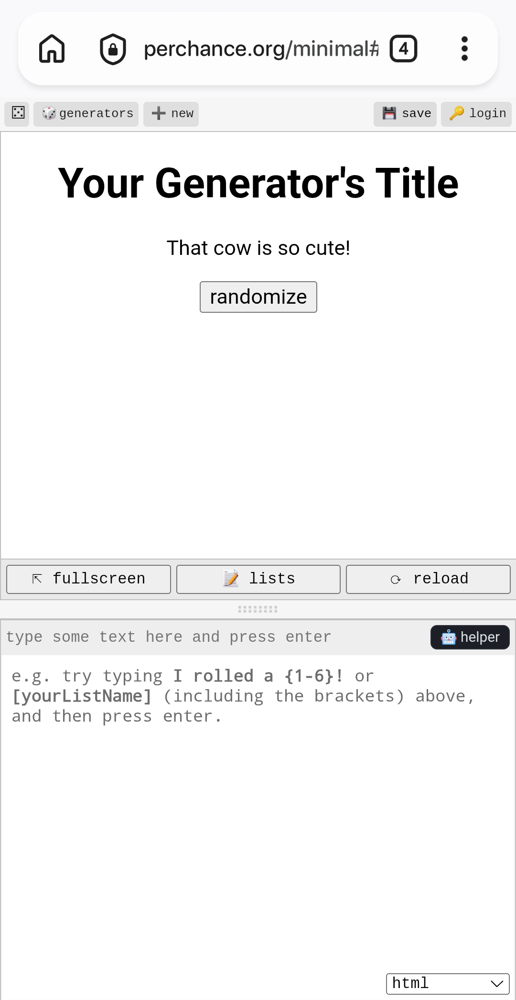 

3. Add this line at the very top of the lists editor. The example lists below it are harmless and can stay.
   (On phones, *Select all* only selects the visible text, so clearing the editor takes several Select all → Delete rounds.)
   ```
   image = {import:text-to-image-plugin}
   ```
   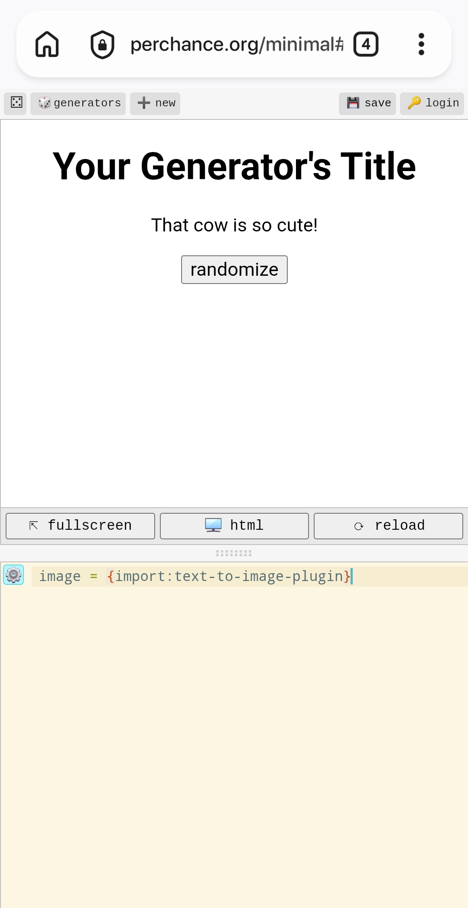

4. Tap the middle button again (it now reads **🖥 html**) to open the HTML editor. Delete all of its default lines
   (repeat Select all → Delete, and scroll sideways to check), then paste the whole of
   [`perchance/generator.html`](https://github.com/purdygeorgeedward-dev/Claude-Perchance/raw/main/perchance/generator.html).

   

5. Tap **reload**. The preview says "Waiting for a prompt from Claude…". Tap **test image**: a fox should appear.
   **test 4** shows four foxes in a swipeable carousel.
   If it does, Perchance is working.

   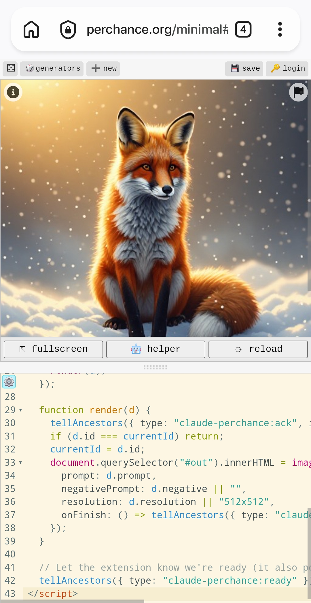

6. Make sure you are logged in, then tap **💾 save** (top right). Saving needs a Perchance account. Perchance gives it a random address such as `perchance.org/mnxb0stnyj`.
7. Optional, to give it a readable name: while logged in, open the **change url** dialog from the top bar,
   type a new url (lower-case letters, numbers and hyphens only, e.g. `claude-perchance`) and tap **set new url**.

   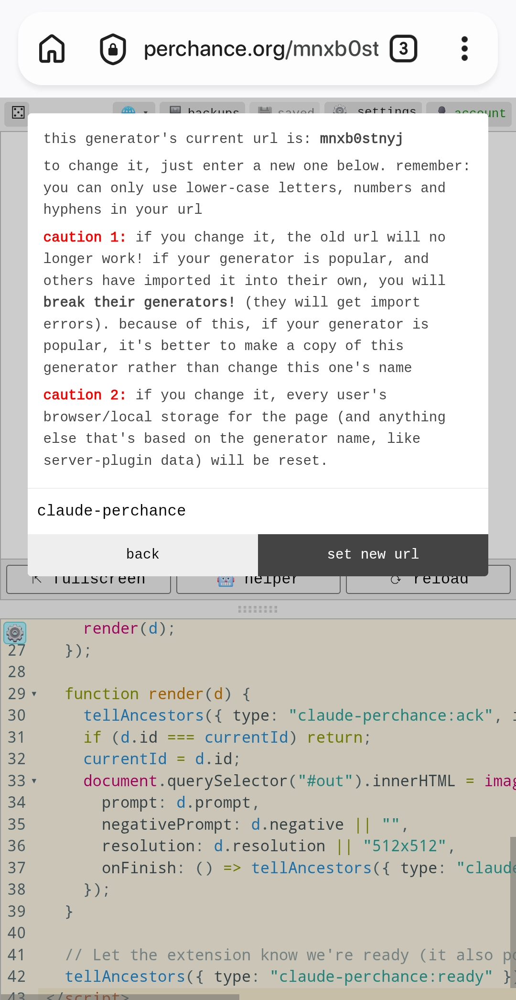

8. Check it saved: open `perchance.org/<your-name>` in a new tab. You should see the "test image" button.
   The part after `perchance.org/` is your **generator name**.

### 2. Install the extension

Tap the file for your browser to download it:
[claude-perchance.zip](https://github.com/purdygeorgeedward-dev/Claude-Perchance/raw/main/packages/claude-perchance.zip) ·
[claude-perchance.crx](https://github.com/purdygeorgeedward-dev/Claude-Perchance/raw/main/packages/claude-perchance.crx) ·
[claude-perchance.xpi](https://github.com/purdygeorgeedward-dev/Claude-Perchance/raw/main/packages/claude-perchance.xpi)

#### Android browsers

| Browser | Can install this file? | How |
|---|---|---|
| **Quetta** | Yes (.zip or .crx) | Menu ︙ → Extensions → **Developer options...** → **(from .zip/.crx/.user.js)** → pick `claude-perchance.zip` (screenshots below) |
| **Lemur** | Yes (.zip or .crx) | Extensions page → load from file |
| **HuBrowser Lite** | Yes (.zip or .crx) | Extensions page → load from file |
| **Microsoft Edge Canary** | Yes (.crx only) | Settings → About Microsoft Edge → tap the version number 7 times → back to Settings → Developer options → "Extension install by crx" → pick `claude-perchance.crx` |
| **Firefox Nightly** | Yes (.xpi, unsigned is allowed) | Settings → About Firefox Nightly → tap the logo 5 times ("Debug menu enabled") → back to Settings → "Install add-on from file" → pick `claude-perchance.xpi` |
| **Iceraven**, **Fennec (F-Droid)** | Probably, same steps as Nightly (unverified) | Same as Firefox Nightly. If it refuses an unsigned file, set `xpinstall.signatures.required` to `false` in `about:config` |
| **Firefox (release/Beta)** | Only once the add-on is signed by Mozilla | Same menu as Nightly, but unsigned files are rejected |
| **Microsoft Edge (stable)** | No, Edge Add-ons store only | Needs a store listing |
| **Yandex, Vivaldi** | Chrome Web Store only | Needs a store listing |
| **Chrome** | No extensions on Android | – |
| **Kiwi** | Discontinued Jan 2025 | – |

#### Quetta, step by step (verified on George's phone)

1. Download `claude-perchance.zip` (link above).
2. Open Quetta's menu ︙ → **Extensions**. The **Manage Extensions (Beta)** page opens.
3. Tap **Developer options...** at the bottom of the page.

   
4. On the **Extensions** page, make sure **Developer mode** is on (top right).
5. Tap **(from .zip/.crx/.user.js)** and pick `claude-perchance.zip`.

   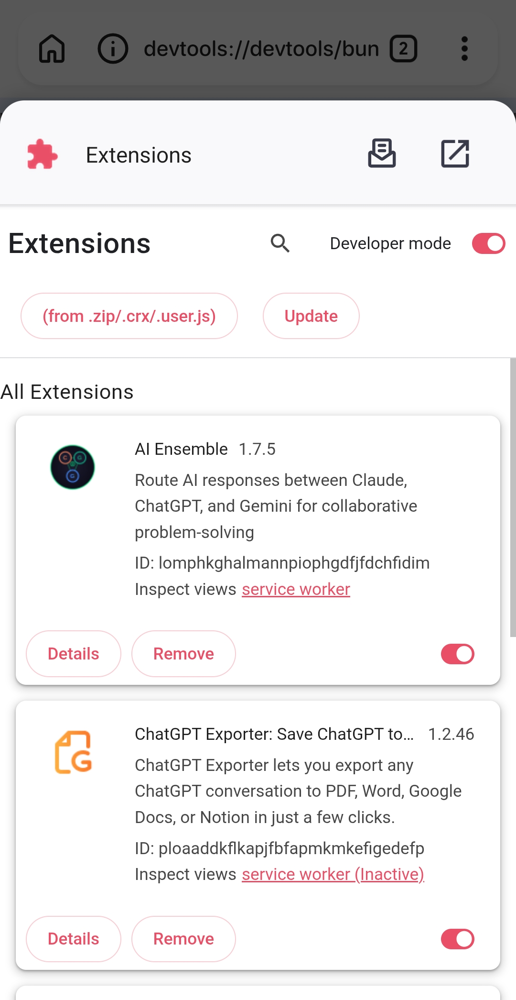
6. Claude Perchance now appears in the list. To install a newer version later, remove the old one and repeat step 5.

#### Desktop

- **Chrome / Edge / Brave:** unzip `claude-perchance.zip`, open `chrome://extensions`, turn on **Developer mode**,
  click **Load unpacked**, pick the unzipped folder.
- **Firefox:** `about:debugging#/runtime/this-firefox` → **Load Temporary Add-on…** → pick `manifest.json`
  (removed on restart; Firefox Developer Edition/Nightly can install the unsigned .xpi permanently with
  `xpinstall.signatures.required` = `false`).

On Firefox (any platform), if images don't appear, open the add-on's permissions and allow it on claude.ai and perchance.org.

### 3. Point the extension at your generator
Open the extension's settings (tap its icon in the browser's extensions menu), type your generator name (e.g. `abcdefgh`), and tap **Save**.

### 4. Teach Claude the tag
Paste the snippet from [`CLAUDE_INSTRUCTIONS.md`](CLAUDE_INSTRUCTIONS.md) into your claude.ai personal preferences
or a Project's instructions. Then ask Claude for a picture.

## Tag syntax

```
[[image: prompt]]
[[image: prompt | portrait]]              512x768
[[image: prompt | landscape]]             768x512
[[image: prompt | square]]                512x512 (default)
[[image: prompt | no: blurry, text]]      negative prompt (default: blurry, low quality, text)
[[image: prompt | seed: 123]]             fixed seed (same seed + prompt ≈ same image)
[[image: prompt | guidance: 9]]           guidance scale 1–30 (Perchance default 7)
[[image: prompt | x4]]                    4 variations in a swipeable carousel (1–8; "count: 4" also works)
[[image: prompt | engine: pollinations]]  draw with Pollinations instead (also: engine: horde, engine: perchance)
[[image: prompt | ref: https://… | blur: 0.3]]  reference image: UNSUPPORTED (tested 2026-11-19, no visible effect)
```

The default number of images per tag can be set in the extension settings ("Images per tag").

Perchance's current model reportedly prefers plain descriptive sentences over keyword lists
(subject → setting → style and lighting → camera details).

`seed`, `guidance` and multiple images need the generator code from v0.2.0 or later (re-paste `perchance/generator.html`);
older generators simply ignore them.

## Engines

| Engine | Cost | Account | Notes |
|---|---|---|---|
| **Perchance** (default) | free | none | Your own generator page; see Setup. |
| **Pollinations** | free | none (an optional key removes the small logo) | Fast. Model set in settings: `flux` (default), `turbo`, others at image.pollinations.ai/models. |
| **AI Horde** | free | none (anonymous key `0000000000`; a free key from aihorde.net/register moves you up the line) | Volunteers' computers draw it, so it can take a few minutes; the card shows your place in line. Models can be named in settings. |

Pick the default in the extension settings (**Default engine**). A tag can choose its own with `engine: …`,
so different projects can use different engines side by side. Images from every engine are saved the same way,
open in **Full size**, and can be made again with **Re-render**. Perchance-only options (`ref:`, `blur:`) are
ignored by the others; `seed`, `guidance`, `no:`, sizes and `x2`–`x8` work everywhere.

## Troubleshooting
- **"Perchance generator didn't respond"**: check the generator name in settings, and open
  `perchance.org/<your-name>` directly once to make sure it saved.
- **Perchance asks you to verify you're human**: click it inside the card; it's a normal Perchance check.
- **"Pollinations / AI Horde: couldn't reach the site"**: the site is down or blocked on your network; tap **Try again** or use another engine.
- **AI Horde waits a long time**: it's volunteer-run; a free API key in settings gets you served sooner.
- **Nothing happens**: reload the claude.ai tab after installing or changing settings.

## Development
`node test/parse.test.js` runs the tag-parser tests. `./build.sh` makes the .zip and .xpi in `dist/`
(the .crx needs a signing key: `npx crx3 -p key.pem -o dist/claude-perchance.crx dist/ext`).

Files: `src/content.js` (finds tags on claude.ai), `src/background.js` (talks to Pollinations and AI Horde, v0.4.0), `src/render.html/js` (extension page that hosts the
Perchance frame so claude.ai's security policy can't block it), `rules.json` (lets Perchance load in a frame),
`perchance/` (code for your generator).
