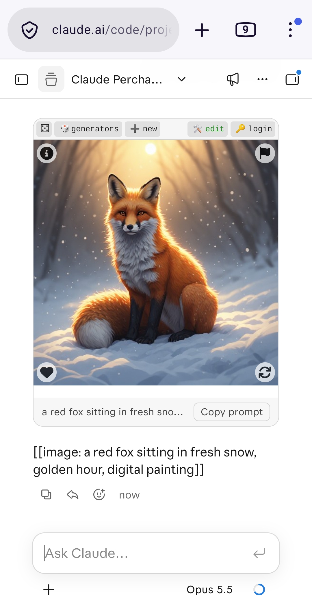
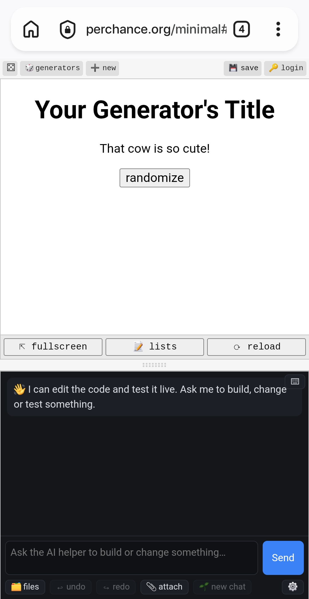
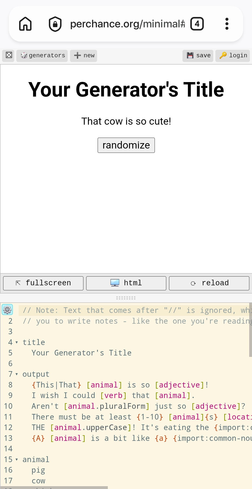
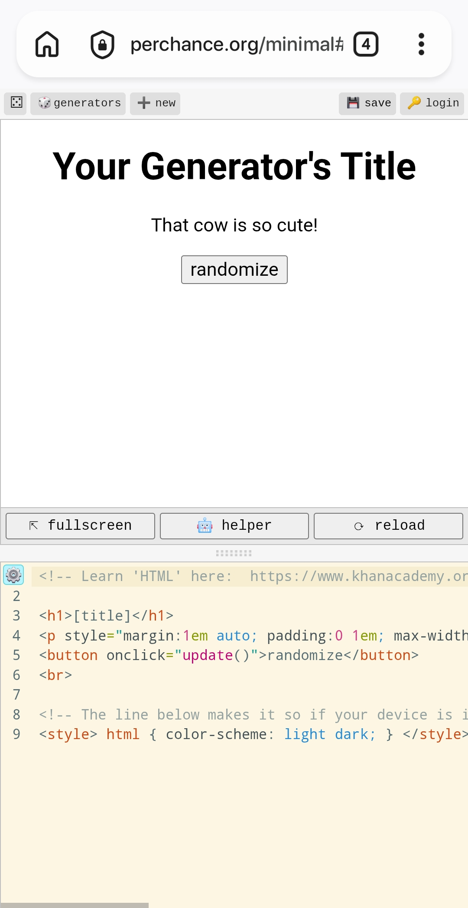
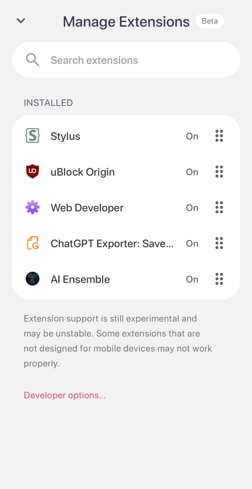

# Claude Perchance

A browser extension that gives claude.ai inline image generation. Claude writes a tag like
`[[image: a red fox in the snow | portrait]]` and the extension renders it right in the chat
using [Perchance](https://perchance.org)'s free text-to-image plugin.

Works on desktop and on Android browsers that run extensions (Quetta, Edge Canary, Firefox Nightly, Iceraven and more; see the table below).



## How it works

1. Claude emits `[[image: ...]]` tags (you teach it with a short instruction snippet).
2. The extension spots finished tags on claude.ai, hides the tag text, and adds an image card under it.
3. The card loads **your own small Perchance generator** and passes it the prompt. The generator renders
   the image with Perchance's `text-to-image-plugin`.

Perchance has no official image API, so this goes through a generator page you own. If Perchance changes how
generators or the plugin work, rendering may break.

## Setup (about 5 minutes)

### 1. Create your Perchance generator

You need a free Perchance account: tap **🔑 login** in Perchance's top bar and sign up first.

These steps were checked on an Android phone. Desktop looks the same, just wider.

1. Log in, then tap **+ new** in the top bar. (Typing `perchance.org/some-name` does **not** create a generator.)
   The bottom pane may open as an **AI helper** chat. Tap the small **keyboard icon** in its top-right corner.

   

2. Now the bottom pane is a **test box** ("type some text here and press enter"). Tap the middle button,
   **📝 lists** (between *fullscreen* and *reload*), to open the lists code editor.

    

3. Add this line at the very top of the lists editor. The example lists below it are harmless and can stay.
   (On phones, *Select all* only selects the visible text, so clearing the editor takes several Select all → Delete rounds.)
   ```
   image = {import:text-to-image-plugin}
   ```
   

4. Tap the middle button again (it now reads **🖥 html**) to open the HTML editor. Delete all of its default lines
   (repeat Select all → Delete, and scroll sideways to check), then paste the whole of
   [`perchance/generator.html`](https://github.com/purdygeorgeedward-dev/Claude-Perchance/raw/main/perchance/generator.html).

   

5. Tap **reload**. The preview says "Waiting for a prompt from Claude…". Tap **test image**: a fox should appear.
   **test 4** shows four foxes in a swipeable carousel.
   If it does, Perchance is working.

   

6. Make sure you are logged in, then tap **💾 save** (top right). Saving needs a Perchance account. Perchance gives it a random address such as `perchance.org/mnxb0stnyj`.
7. Optional, to give it a readable name: while logged in, open the **change url** dialog from the top bar,
   type a new url (lower-case letters, numbers and hyphens only, e.g. `claude-perchance`) and tap **set new url**.

   

8. Check it saved: open `perchance.org/<your-name>` in a new tab. You should see the "test image" button.
   The part after `perchance.org/` is your **generator name**.

### 2. Install the extension

Tap the file for your browser to download it:
[claude-perchance.zip](https://github.com/purdygeorgeedward-dev/Claude-Perchance/raw/main/packages/claude-perchance.zip) ·
[claude-perchance.crx](https://github.com/purdygeorgeedward-dev/Claude-Perchance/raw/main/packages/claude-perchance.crx) ·
[claude-perchance.xpi](https://github.com/purdygeorgeedward-dev/Claude-Perchance/raw/main/packages/claude-perchance.xpi)

#### Android browsers

| Browser | Can install this file? | How |
|---|---|---|
| **Quetta** | Yes (.zip or .crx) | Menu ︙ → Extensions → **Developer options...** → **(from .zip/.crx/.user.js)** → pick `claude-perchance.zip` (screenshots below) |
| **Lemur** | Yes (.zip or .crx) | Extensions page → load from file |
| **HuBrowser Lite** | Yes (.zip or .crx) | Extensions page → load from file |
| **Microsoft Edge Canary** | Yes (.crx only) | Settings → About Microsoft Edge → tap the version number 7 times → back to Settings → Developer options → "Extension install by crx" → pick `claude-perchance.crx` |
| **Firefox Nightly** | Yes (.xpi, unsigned is allowed) | Settings → About Firefox Nightly → tap the logo 5 times ("Debug menu enabled") → back to Settings → "Install add-on from file" → pick `claude-perchance.xpi` |
| **Iceraven**, **Fennec (F-Droid)** | Probably, same steps as Nightly (unverified) | Same as Firefox Nightly. If it refuses an unsigned file, set `xpinstall.signatures.required` to `false` in `about:config` |
| **Firefox (release/Beta)** | Only once the add-on is signed by Mozilla | Same menu as Nightly, but unsigned files are rejected |
| **Microsoft Edge (stable)** | No, Edge Add-ons store only | Needs a store listing |
| **Yandex, Vivaldi** | Chrome Web Store only | Needs a store listing |
| **Chrome** | No extensions on Android | – |
| **Kiwi** | Discontinued Jan 2025 | – |

#### Quetta, step by step (verified on George's phone)

1. Download `claude-perchance.zip` (link above).
2. Open Quetta's menu ︙ → **Extensions**. The **Manage Extensions (Beta)** page opens.
3. Tap **Developer options...** at the bottom of the page.

   
4. On the **Extensions** page, make sure **Developer mode** is on (top right).
5. Tap **(from .zip/.crx/.user.js)** and pick `claude-perchance.zip`.

   
6. Claude Perchance now appears in the list. To install a newer version later, remove the old one and repeat step 5.

#### Desktop

- **Chrome / Edge / Brave:** unzip `claude-perchance.zip`, open `chrome://extensions`, turn on **Developer mode**,
  click **Load unpacked**, pick the unzipped folder.
- **Firefox:** `about:debugging#/runtime/this-firefox` → **Load Temporary Add-on…** → pick `manifest.json`
  (removed on restart; Firefox Developer Edition/Nightly can install the unsigned .xpi permanently with
  `xpinstall.signatures.required` = `false`).

On Firefox (any platform), if images don't appear, open the add-on's permissions and allow it on claude.ai and perchance.org.

### 3. Point the extension at your generator
Open the extension's settings (tap its icon in the browser's extensions menu), type your generator name (e.g. `abcdefgh`), and tap **Save**.

### 4. Teach Claude the tag
Paste the snippet from [`CLAUDE_INSTRUCTIONS.md`](CLAUDE_INSTRUCTIONS.md) into your claude.ai personal preferences
or a Project's instructions. Then ask Claude for a picture.

## Tag syntax

```
[[image: prompt]]
[[image: prompt | portrait]]              512x768
[[image: prompt | landscape]]             768x512
[[image: prompt | square]]                512x512 (default)
[[image: prompt | no: blurry, text]]      negative prompt (default: blurry, low quality, text)
[[image: prompt | seed: 123]]             fixed seed (same seed + prompt ≈ same image)
[[image: prompt | guidance: 9]]           guidance scale 1–30 (Perchance default 7)
[[image: prompt | x4]]                    4 variations in a swipeable carousel (1–8; "count: 4" also works)
[[image: prompt | ref: https://… | blur: 0.3]]  reference image: UNSUPPORTED (tested 2026-11-19, no visible effect)
```

The default number of images per tag can be set in the extension settings ("Images per tag").

Perchance's current model reportedly prefers plain descriptive sentences over keyword lists
(subject → setting → style and lighting → camera details).

`seed`, `guidance` and multiple images need the generator code from v0.2.0 or later (re-paste `perchance/generator.html`);
older generators simply ignore them.

## Troubleshooting
- **"Perchance generator didn't respond"**: check the generator name in settings, and open
  `perchance.org/<your-name>` directly once to make sure it saved.
- **Perchance asks you to verify you're human**: click it inside the card; it's a normal Perchance check.
- **Nothing happens**: reload the claude.ai tab after installing or changing settings.

## Development
`node test/parse.test.js` runs the tag-parser tests. `./build.sh` makes the .zip and .xpi in `dist/`
(the .crx needs a signing key: `npx crx3 -p key.pem -o dist/claude-perchance.crx dist/ext`).

Files: `src/content.js` (finds tags on claude.ai), `src/render.html/js` (extension page that hosts the
Perchance frame so claude.ai's security policy can't block it), `rules.json` (lets Perchance load in a frame),
`perchance/` (code for your generator).
