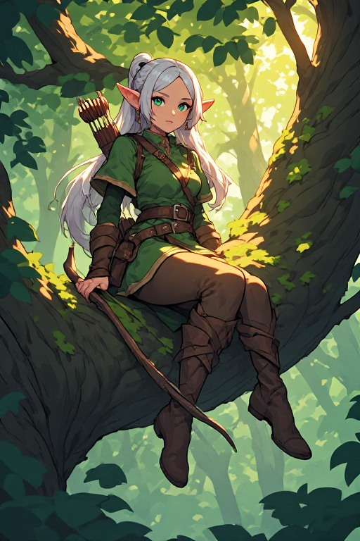
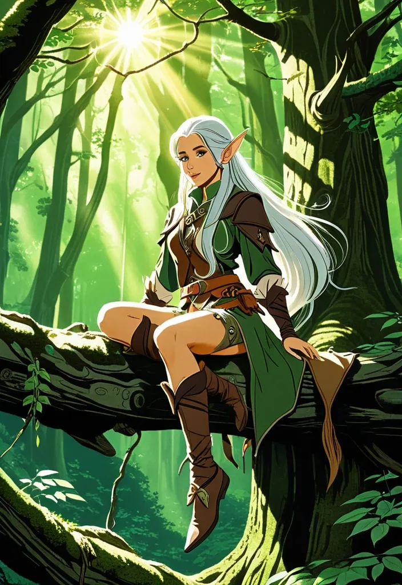
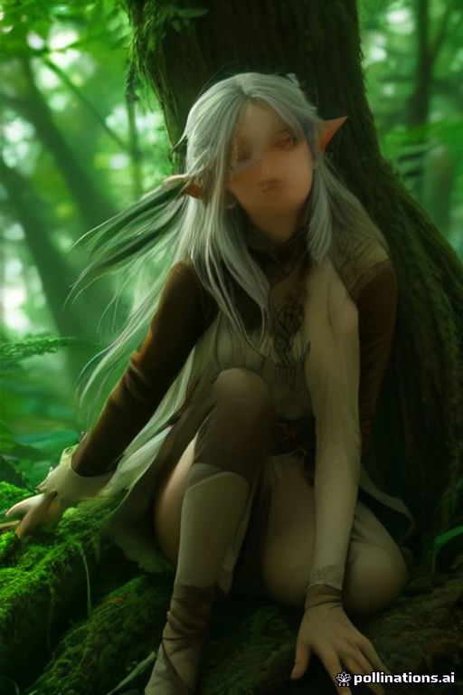

# Engines

Claude's Drawing Hand can draw with three image engines. Claude writes the same `[[image: …]]` tag for all of
them. The engine is picked by your settings, or by `engine: …` inside a tag.

| | [Perchance](perchance.md) | [AI Horde](ai-horde.md) | [Pollinations](pollinations.md) |
|---|---|---|---|
| Cost | free | free | free without a key; with a key, each image uses your Pollen credit |
| Account | a free Perchance account for your own generator | none (a free key gets you served sooner) | none (a key unlocks models and edits) |
| Speed | a few seconds | seconds to minutes (volunteer computers, you wait in line) | a few seconds; without a key, one image at a time |
| Models | Perchance's own | many, run by volunteers | without a key, one; with a key, many |
| Edit a picture (`ref:`) | no (ignored) | yes | with a key |
| Biggest size | set by Perchance | multiples of 64 | 768px without a key |
| Gallery | [Perchance gallery](perchance.md#gallery) | [AI Horde gallery](ai-horde.md#gallery) | [Pollinations gallery](pollinations.md#gallery) |

**After installing or updating the extension, reload the claude.ai tab.** Until you do, the page keeps the old
version (or none) and nothing renders.

## Side by side: the elf archer (2026-11-22)

The same anime elf prompt on each engine, no keys. George's verdict: **Perchance drew the best anime character.**

Perchance (best: crisp anime, strong face) · AI Horde (clean retro anime, good face) · Pollinations without a key
(semi-photoreal, face melted).

## Choosing an engine

- **Default engine** in the extension settings decides what every tag uses.
- A tag can choose its own: `engine: perchance`, `engine: horde` or `engine: pollinations`.
  Ask Claude in your own words, for example "use AI Horde for this one".
- **Fallback** (setting **If an engine fails, use the default engine, then Perchance**, on by default): if an engine
  fails, the card tries your default engine, then Perchance. A line under the prompt says what happened.

## Tag options on each engine

| Option | Perchance | AI Horde | Pollinations |
|---|---|---|---|
| `portrait` / `landscape` / `square` / `512x768` | yes | yes (rounded to multiples of 64) | yes (768px max without a key) |
| `no: …` (negative prompt) | yes | yes | without a key only |
| `seed: 123` | yes | yes | yes |
| `guidance: 9` | yes (1–30) | yes (capped at 10) | no |
| `x2`, `x4`, `x8` | yes | yes (one job) | yes (one image after another) |
| `ref: https://… ` + `strength: 0.5` | no | yes | with a key |

`strength` is how far an edit may move away from the original picture: 0 keeps it, 1 ignores it. The default is 0.6.

## For developers

Every engine is an adapter in [`src/engines.js`](../../src/engines.js) with the same commands:

| Command | What it does |
|---|---|
| `generate_image` | Start drawing. Answers with the images, or with a job to check on. |
| `edit_image` | The same, starting from a picture (`ref:`). |
| `get_image` | Check a job. Answers "still waiting" (place in line, seconds left) or the images. |
| `list_models` | The models the engine offers right now (the **Show models** buttons in settings). |
| `capabilities` | What the engine can do with the current settings (for example, whether it can edit). |

Adding an engine means adding one adapter object to `ADAPTERS`, a name to `ENGINE_NAMES` in `content.js`,
its site to `host_permissions` in `manifest.json`, and a doc page here. Perchance is drawn in a frame on the chat
page rather than through an API, so it has no adapter and is always the last step of a fallback.
