# Perchance

The original engine and still the default. Your own free generator page on perchance.org draws the image inside
the chat. Setup is in the [main README](../../README.md#setup-about-5-minutes).

- **Cost:** free.
- **Account:** a free Perchance account, so your generator can have a name (George's is `claude-perchance`).
- **Settings:** **Perchance generator name**.
- **Tag options:** sizes, `no:`, `seed:`, `guidance:` (1–30), `x2`–`x8`.
- **Can't do:** edit a picture. Perchance ignores reference pictures (tested 2026-11-19), so a tag with `ref:`
  uses AI Horde instead when fallback is on.
- **Style notes:** Perchance's model prefers plain descriptive sentences: subject, setting, style and lighting,
  then camera details.

## Troubleshooting

- **"Perchance generator didn't respond":** check **Perchance generator name** in settings, and open
  `perchance.org/<your-name>` once to make sure it saved.
- **Stuck on Cloudflare's "Starting..." check in Titanium:** Titanium's WebRTC protection blocks it. In Titanium,
  Settings > Privacy and security > WebRTC IP handling policy, change it away from "Disable non-proxied UDP"
  (confirmed by George on 2026-11-20).

## Gallery

All made by Claude with Perchance, inside the chat. Images live in [`docs/gallery/perchance/`](../gallery/perchance/).

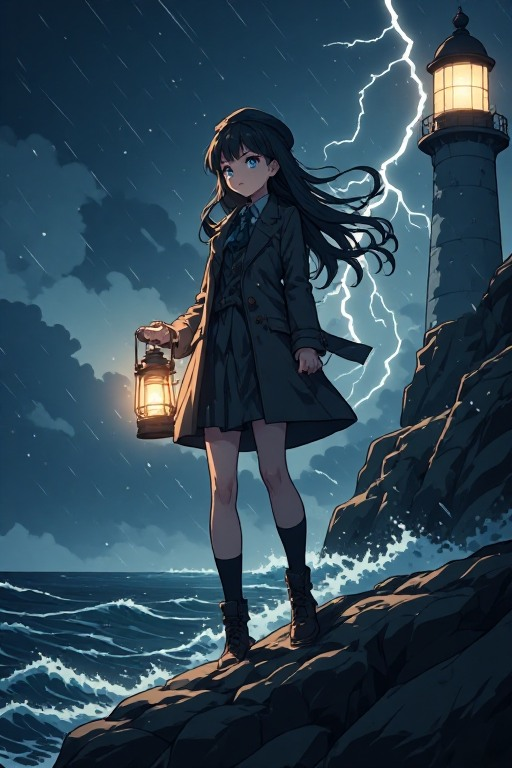
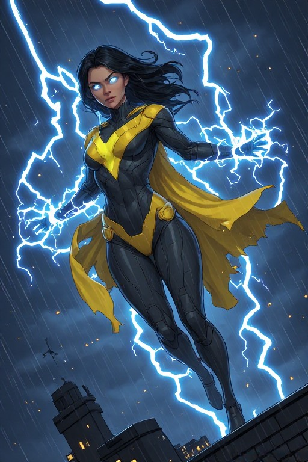
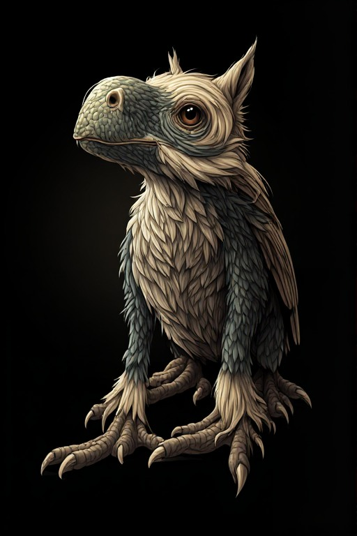
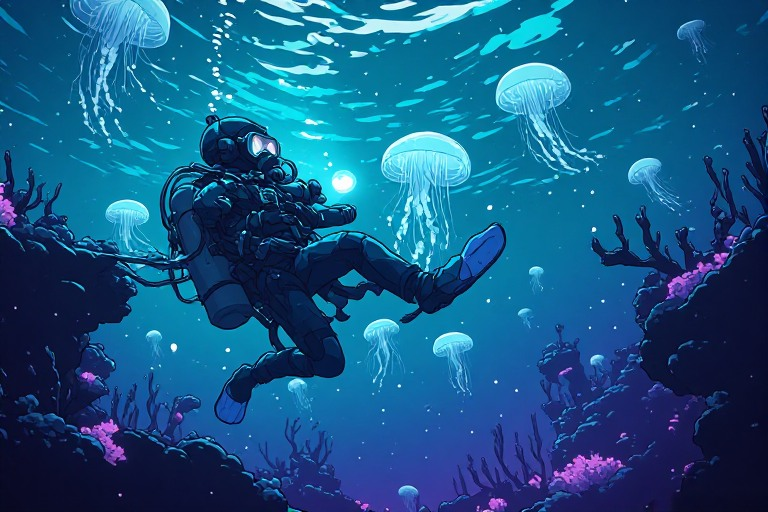
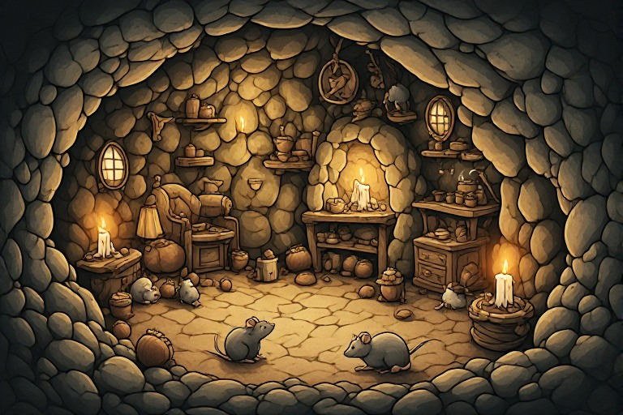
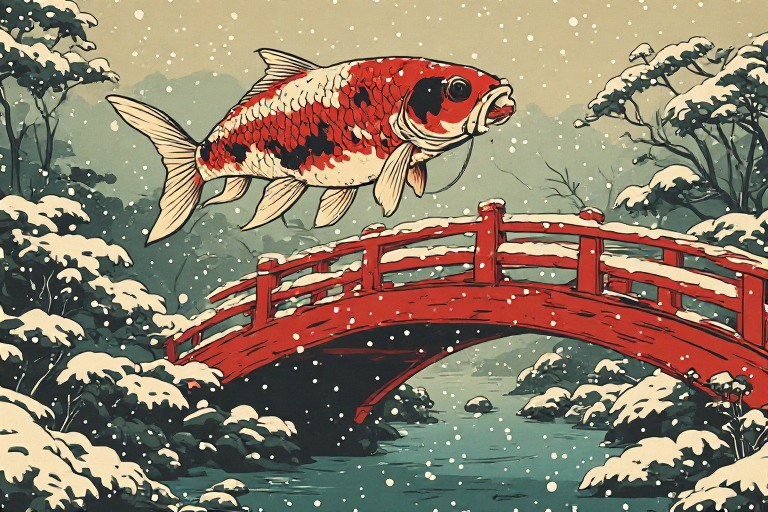
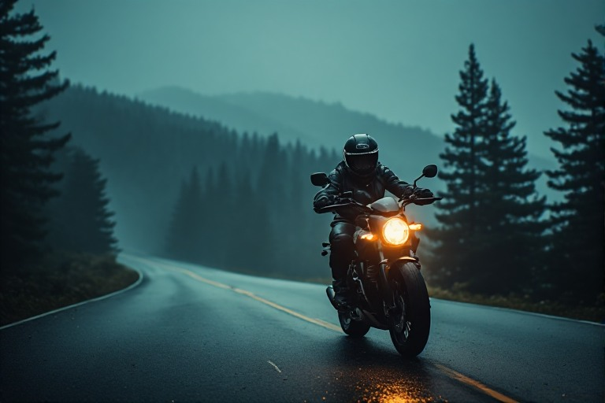
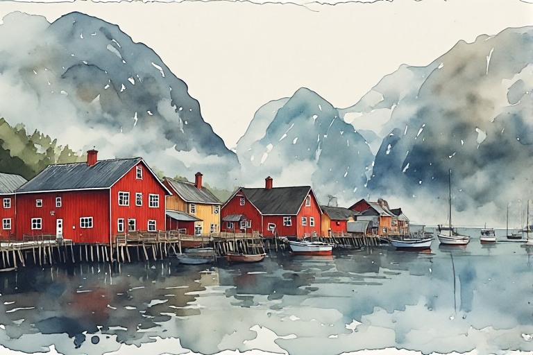
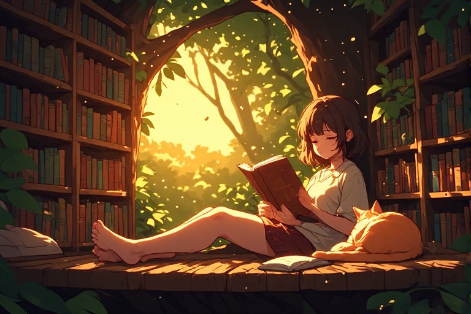
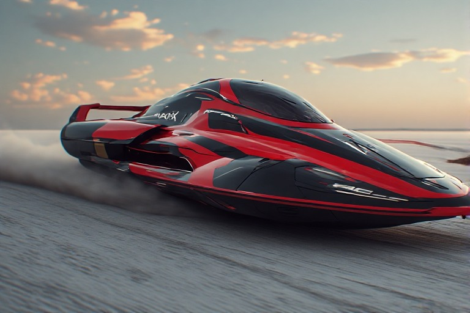
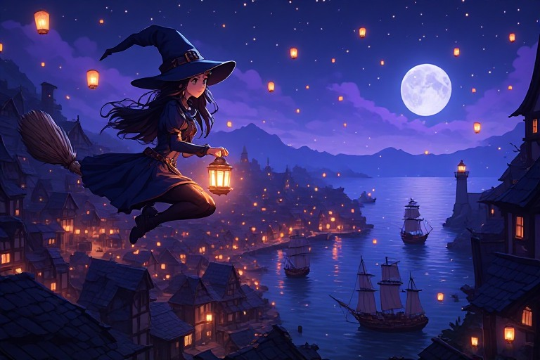
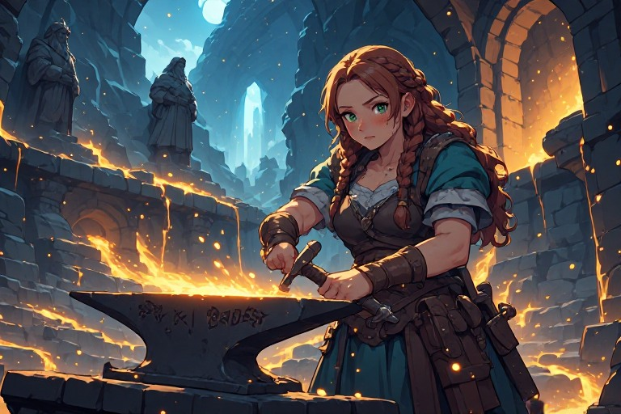
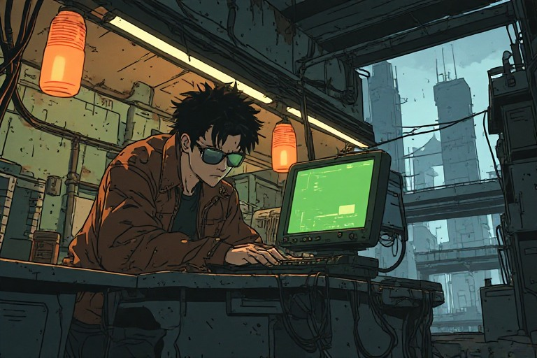
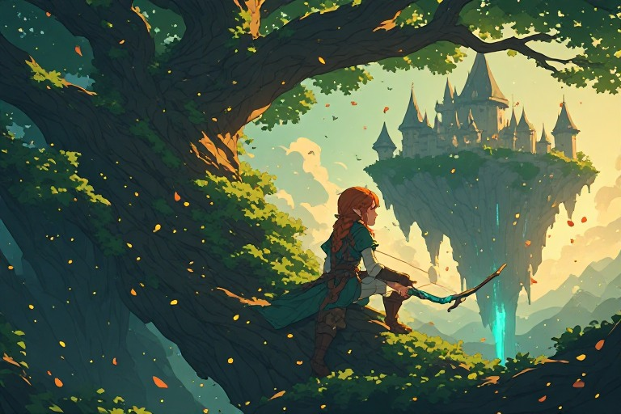
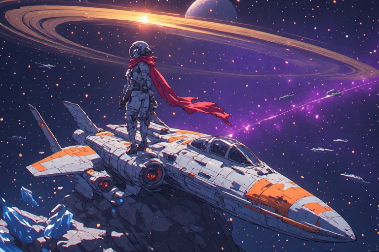
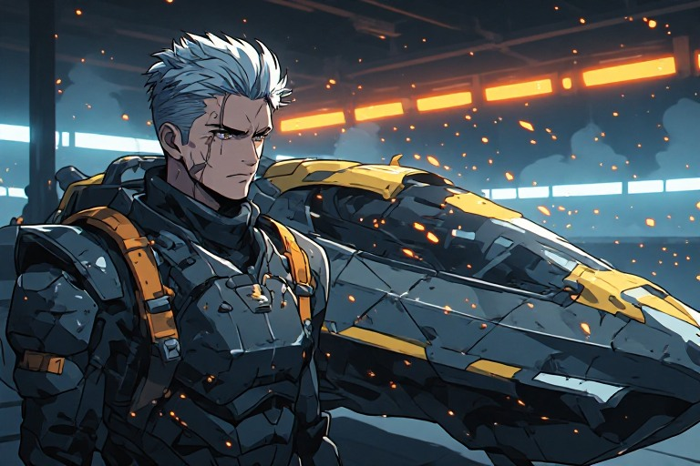
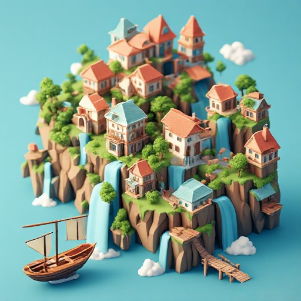
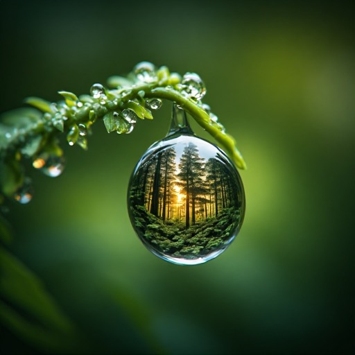
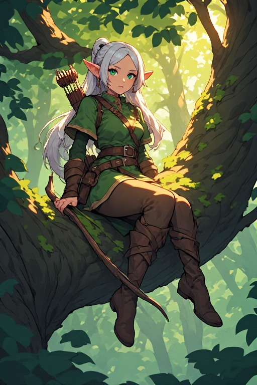

To compare engines on the same prompts, see [the comparison set](comparison-prompts.md).
