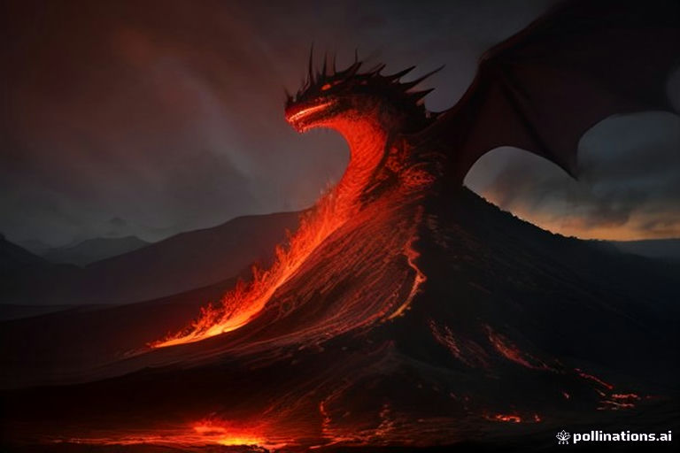
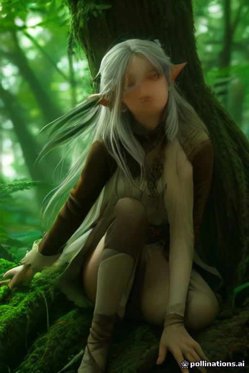
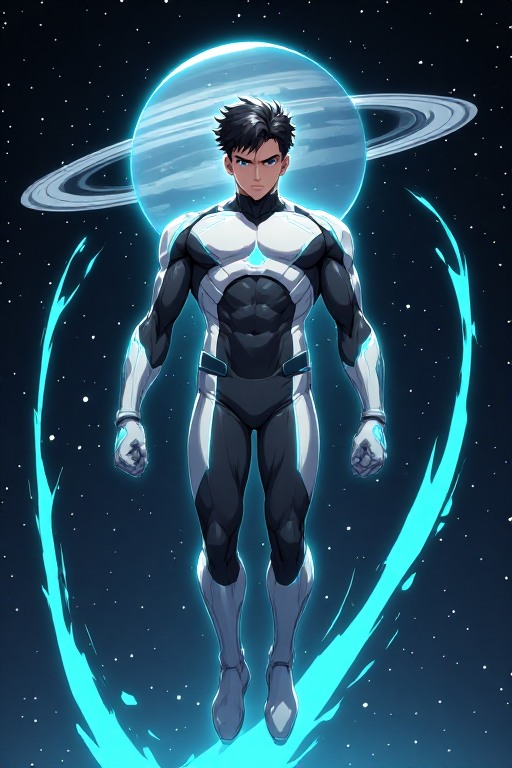

# Pollinations

A fast image service with many models. Checked against its API docs on 2026-11-22: keyless use still works but is
limited, and a key unlocks the full service, paid with Pollinations' credit ("Pollen").

- **Without a key:** free, one model, a small logo on the image, at most 768px, and one image at a time. For `x4`
  the card draws them one after another and waits when Pollinations says "too many requests".
- **With a key:** any model and picture edits, through `gen.pollinations.ai`. Each image uses Pollen. The free hourly
  Pollen refill ended in July 2026, so plan on buying credit. Keys come from [enter.pollinations.ai](https://enter.pollinations.ai).
- **Settings:**
  - **Pollinations key (optional)**: paste your key, or leave it empty for free use. The key stays in the extension's
    settings and is only sent to Pollinations.
  - **Pollinations model**: only used with a key. Empty means Pollinations' default. **Show models** lists them; tap one to use it.
- **Tag options:** sizes, `seed:`, `x2`–`x8`; `no:` without a key only; `ref:` with a key. `guidance:` is ignored.

## Troubleshooting

- **"the key was refused":** check the key in **Pollinations key (optional)**.
- **"out of credit or too many requests":** with a key, your Pollen may have run out.
- **"free use allows one image at a time; waiting":** normal without a key; the card retries by itself.

## Gallery

Images live in [`docs/gallery/pollinations/`](../gallery/pollinations/). Made from [the comparison set](comparison-prompts.md)
so they can be compared with the other engines.

1. **Red dragon** (no key, 768x512, with the Pollinations logo; 2026-11-22). The dragon came out fused into the
   mountain.
   `[[image: A massive ancient red dragon perched on a jagged volcanic peak, wings spread wide, crimson scales glinting, horns curved, fire glowing in its jaws, lava rivers in the valley below. Detailed high-fantasy digital painting, dramatic firelight. | landscape | no: text, blurry, cartoon]]`
2. **Elf archer** (no key, 512x768, 2026-11-22, Quetta). The same anime elf prompt that Perchance drew in the
   Perchance gallery, with `engine: pollinations`. It came out semi-photoreal instead of anime, and the face melted
   away. An honest example of the keyless tier.
3. **Space hero** (no key, 512x768, 2026-11-22). A centered, full-body anime superhero in a black and white suit,
   a ringed planet behind him and cyan energy streaks, drawn with `engine: pollinations`. The keyless tier did well here.
